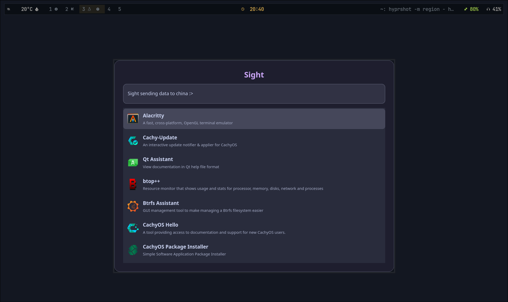
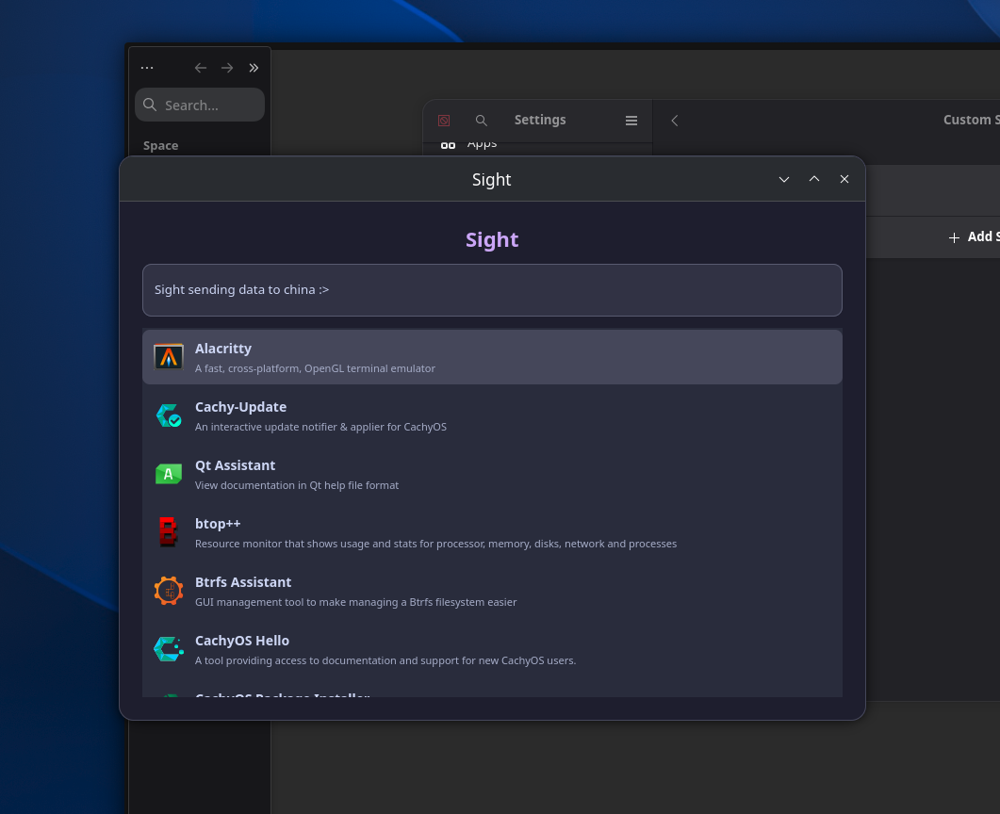
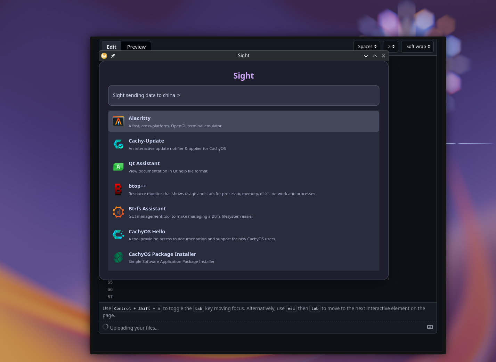

# Sight
> for reviewer: I had cleaned up code from main.rs to diffrent files in some commits thats why it shows 4hrs on the main.rs because I test the stuff there first ofc you can find that commits with the appropriate msgs too (writing cuz forgot to mention it on the 'for reviewer' box)
An app launcher written in rust.
Current rice!!

## Overview

`Sight` is a simple lightweight gtk launcher that searches for applications on your linux machine and lets you run whatever application you choose to from the app menu by searching or moving through with the arrow keys (just like how app launchers work!)

Sight uses `relm4` with `GTK4` for it's UI :)

## Build

Need rust and cargo installed to build

```
git clone https://github.com/lxsh-S/Sight.git
cd Sight
cargo build
```

## INSTALLATION
> Note: `sight` is named as `sight-launcher` when installing using cargo  
- Currently `sight` can only be installed via cargo: https://crates.io/crates/sight-launcher (or)
```
cargo install sight-launcher
```


## Configure with Hyprland
Add this to your autostart.lua or `hyprland.lua` if you wanna keep things in one file:
- set a variable
```
local menu = "sight-launcher"
```
- Add a keybind `:P`
```
hl.bind(mainMod .. " + R", hl.dsp.exec_cmd(menu))
```
- You also would need to write a window rule for the launcher
```
overlayLayerRule:set_enabled(false)

hl.window_rule({
    name = "sight-launcher",
    match = {
        class = "^(dev\\.lxsh\\.sight)$",
    },

    float = true,
    center = true,
    size = "500 600",
    stay_focused = true,
    pin = true,
})
```


## Configure with Gnome and Kde

I recommend:

Setting | Value |
|---|---|
| Name | Sight |
| Command | `sight-launcher` |
| Shortcut | `Super + R` | 

Feel free to customize the shortcut keys!

### Gnome
- Open `settings` -> `keyboard`
- find `View and customize shortcuts` -> `Custom shortcuts`
- Add a new shortcut



### Kde Plasma
- Open `System settings` -> `keyboard` -> `shortcuts`
- Add a new `command` shortcut


